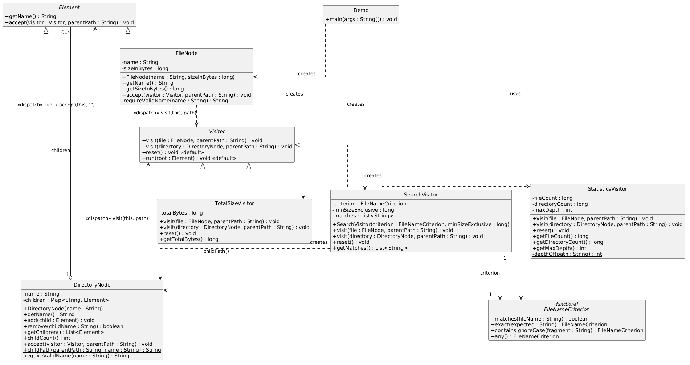

# Visitor Pattern 

**Student:** Dayana Zharylgapova
**Group:** SE-2538

---

## 1. Purpose and Design Choices

The goal is an in-memory hierarchical file system with three independent operations over the same structure: total size, filename + size search, and statistics (file/directory counts, max depth). The **Visitor pattern** is used so operations can be added without modifying element classes.

### Object model

- `Element` — common interface: `getName()` and `accept(Visitor, String parentPath)`.
- `FileNode` — leaf; validated name and a `long` non-negative byte size.
- `DirectoryNode` — composite; ordered `LinkedHashMap<String, Element>` of children so insertion order is deterministic and duplicate names are rejected in O(1).

### Double dispatch

Each element implements `accept`:

    // FileNode
    public void accept(Visitor v, String parentPath) { v.visit(this, parentPath); }

    // DirectoryNode
    public void accept(Visitor v, String parentPath) {
        String myPath = childPath(parentPath, name);
        v.visit(this, myPath);
        for (Element c : getChildren()) c.accept(v, myPath);
    }

The first dispatch is `element.accept(v)` (dynamic on the element); the second is `v.visit(this, …)` (overload resolved on the element's static type inside the element). The visitor never inspects the element type — **no `instanceof`, `getClass()`, reflection, or casts**.

### Traversal owner

Traversal lives in the **elements** (pre-order: visit self, then children in insertion order). `Visitor.run(root)` is a template method: `reset(); root.accept(this, "");`. This guarantees exactly one visit per reachable node per operation, supports nested and empty directories, and keeps visitors as pure operations.

### Paths and depth

`childPath` returns `""` for the root named `"root"`, otherwise `parent + "/" + name` — all paths are **root-relative** with `/` separators. `SearchVisitor.getMatches()` returns a sorted copy (lexicographic). `StatisticsVisitor.depthOf` counts `/` separators; root depth = 0.

### Controlled state

Every visitor overrides `reset()`; `run(...)` calls it before each traversal. Visitors are reusable and outputs are independent of run order (verified by tests).

### Integrity

Negative sizes, blank names, `/` in names, duplicate sibling names, and self-containment are rejected with `IllegalArgumentException`. `getChildren()` returns an unmodifiable list copy. Multiple-parent ownership is prevented structurally — an element is placed into exactly one child map and there is no reparent API.

### Extensibility

A new operation = a new `Visitor` class only. `StatisticsVisitor` was added after `TotalSizeVisitor` and `SearchVisitor` with **zero changes** to element classes or `accept`. Trade-off: adding a new **element type** (e.g., `SymlinkNode`) requires a new `visit` overload in every visitor and a new `accept` implementation — operations are open, element types are closed.

---

## 2. UML Class Diagram

**Relationships**

- `FileNode` and `DirectoryNode` *implement* `Element`.
- `DirectoryNode` *aggregates* `0..*` `Element` children .
- `TotalSizeVisitor`, `SearchVisitor`, `StatisticsVisitor` *implement* `Visitor`.
- `SearchVisitor` *assosiation 1* `FileNameCriterion`.
- Double dispatch: accept(...) calls visit(this, ...); Visitor.run(...) calls accept(...).

---

## 3. Five Clean Code Justifications

1. **Meaningful naming.** `TotalSizeVisitor.getTotalBytes()`, `SearchVisitor.minSizeExclusive`, `DirectoryNode.childPath(...)`, `StatisticsVisitor.getMaxDepth()` state intent without needing comments — names encode units, semantics (`>` exclusive), and result type.

2. **Single Responsibility.** `FileNode` validates a file; `DirectoryNode` enforces sibling/cycle invariants; each visitor performs exactly one operation. `Demo.java` only wires data and prints — no business logic.

3. **Small methods.** `FileNode.accept` is a single delegation line; `DirectoryNode.childPath` is a 4-line pure function; `depthOf` is a short loop. Each is trivially testable in isolation and easy to trace during defense.

4. **Encapsulation.** `DirectoryNode.children` is private; `getChildren()` returns `Collections.unmodifiableList(new ArrayList<>(...))` so callers cannot mutate internal state (asserted in `IntegrityTest.validNestingAndChildCollectionIsUnmodifiable`). Invariants (unique names, no self-containment) are enforced only through `add(...)`.

5. **Elimination of type-checking chains.** There is no `instanceof` / `getClass()` / cast anywhere in visitor or element code — behavior is selected purely by overload resolution (`visit(FileNode,…)` vs `visit(DirectoryNode,…)`). Adding `StatisticsVisitor` required no edit to any element class; the extension boundary is the `Visitor` interface.

---

## 4. Sample Output

Running `mvn compile exec:java` on the `Demo` tree (docs/report.pdf 1024, docs/notes.txt 200, docs/nested/deep.txt 50, images/photo.png 5000, images/diagram.png 800, readme.md 120):

    Total size: 7194 bytes
    Search (.txt, >40 bytes): [docs/nested/deep.txt, docs/notes.txt]
    Stats -> files=6 dirs=4 maxDepth=3

Path derivation: `docs` (depth 1) → `nested` (depth 2) → `deep.txt` (depth 3) gives `maxDepth=3`; directories counted: `root, docs, images, nested` = 4; files = 6.

---

## 5. Test Summary

Suite: `DispatchTest`, `TotalSizeVisitorTest`, `SearchVisitorTest`, `StatisticsVisitorTest`, `EdgeCaseTest`, `IntegrityTest` — 13 tests total, covering T1–T8.

    [INFO] Tests run: 13, Failures: 0, Errors: 0, Skipped: 0
    [INFO] BUILD SUCCESS

Key assertions:

- **T1** file → `visit(FileNode)` (1 file hit, 0 dir hits); dir → `visit(DirectoryNode)`.
- **T2** 100 + 200 + 300 across 3 levels = 600.
- **T3/T4** `.txt` && `>100` → `[docs/alpha.txt, docs/sub/gamma.txt]`; full search sorted lexicographically.
- **T5** 3 files, 3 dirs, depth 3; empty root → 0 files, 1 dir, depth 0.
- **T6** empty root → size 0 and empty matches; no-match → empty list; deep nested + empty dir traversed.
- **T7** three repeated runs → 42, not 126.
- **T8** negative size, duplicate sibling, self-containment all throw `IllegalArgumentException`; `getChildren().add(...)` throws `UnsupportedOperationException`.

### T1–T8 mapping

| Checkpoint | Test class / method |
|---|---|
| T1 dispatch | `DispatchTest.fileNodeDispatchesToFileOverload`, `directoryNodeDispatchesToDirectoryOverload` |
| T2 size | `TotalSizeVisitorTest.sumsAcrossMultipleNestingLevels` |
| T3 search filters | `SearchVisitorTest.combinesNameAndSizeFilters` |
| T4 deterministic paths | `SearchVisitorTest.producesSortedRootRelativePathsWithSlashSeparator` |
| T5 statistics | `StatisticsVisitorTest.countsFilesDirectoriesAndMaxDepth`, `emptyRootDirectoryIsCountedWithDepthZero` |
| T6 edge cases | `EdgeCaseTest.emptyRootHasZeroSizeAndNoMatches`, `noMatchSearchReturnsEmptyList`, `deeplyNestedAndEmptyDirectoriesAreTraversed` |
| T7 repeat runs | `TotalSizeVisitorTest.repeatedRunsDoNotAccumulate` |
| T8 integrity | `IntegrityTest.rejectsNegativeFileSize`, `rejectsDuplicateSiblingNames`, `rejectsSelfContainmentCycle`, `validNestingAndChildCollectionIsUnmodifiable` |

---

## 6. Traversal & Extension Trade-offs

**Traversal in elements** was chosen over a separate walker because (a) it keeps each visitor a pure operation with no traversal code, (b) it guarantees exactly-one-visit semantics uniformly for all three visitors, and (c) adding a visitor requires no traversal changes. The cost: traversal order is fixed by the element (`LinkedHashMap` insertion order); a visitor that needs a different order (e.g., post-order) would need a separate traversal strategy.

**Visitor extensibility** is asymmetric by design: new operations are open (add a class), new element types are closed (must touch every visitor). For this domain — a stable file/directory vocabulary with many potential operations (size, search, stats, future hashing/export) — that asymmetry is favorable. If element types were expected to grow, a combined approach (e.g., default `visit` methods + sealed hierarchy) would be preferable.

---

## 7. Repository

- **GitHub:** `https://github.com/Tokisao/visitor`
- **Run tests:** `mvn test`
- **Run demo:** `mvn compile exec:java`

---